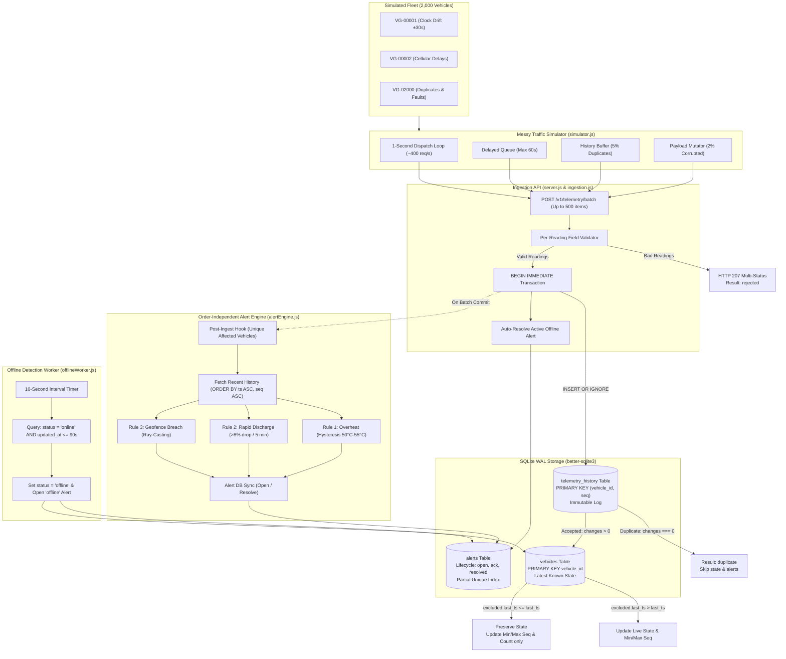
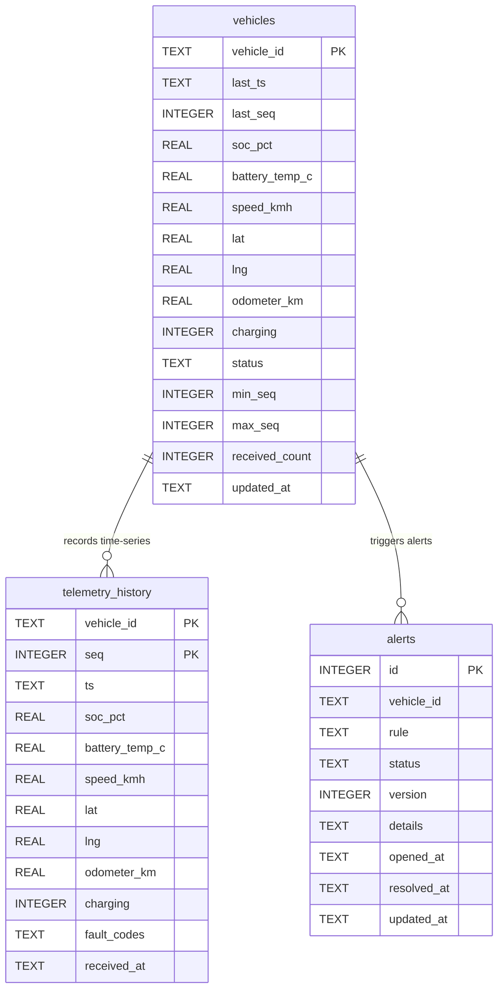
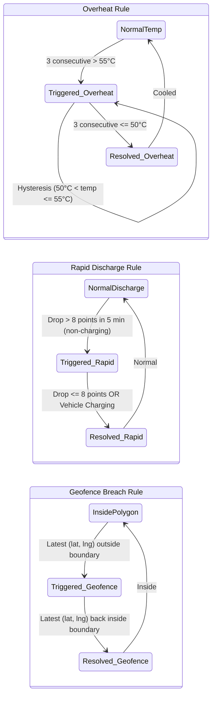

# VoltGrid Fleet Telemetry Service — Master Plan & Tutorial Guide (Phase 1 & Phase 2)

This document is the complete architectural master plan and tutorial guide for **Phase 1** (Batch Ingestion, SQLite Storage, and Messy Traffic Simulator) and **Phase 2** (Order-Independent Alert Engine, Alert Lifecycle, and Offline Detection Worker) of the VoltGrid Fleet Telemetry Service.

Use this guide to explain the system end-to-end during code reviews, interviews, and technical demonstrations.

---

## 1. System Overview & The Core Engineering Challenge

### The Real-World Scenario
VoltGrid operates a commercial fleet of **2,000 electric two-wheelers** across a metropolitan area. Every 5 seconds, each vehicle transmits sensor telemetry over cellular networks:
* State of Charge (`soc_pct`)
* Battery Temperature (`battery_temp_c`)
* Current Speed (`speed_kmh`) & Odometer (`odometer_km`)
* GPS Coordinates (`lat`, `lng`)
* Charging Status (`charging`) & Diagnostic trouble codes (`fault_codes`)

At full scale, the fleet generates **~400 readings per second** (roughly 35 million readings per day).

### The Cellular Network Realities ("Messy Input")
In real-world IoT networks, cellular connections are notoriously unreliable:
1. **Network Retries & Duplicates**: When an ACK is delayed, firmware resends readings (~5% duplicate rate).
2. **Out-of-Order & Delayed Delivery**: Vehicles driving through tunnels or dead zones buffer readings and dump them in bursts up to 10 minutes later (~10% delayed rate).
3. **Clock Drift**: Device RTC (Real-Time Clocks) are not atomic and drift by ±30 seconds relative to the server clock.
4. **Corrupted / Malformed Payloads**: Faulty sensors or bit flips send impossible values (e.g., `soc_pct: 140%`, negative speeds, missing IDs).
5. **Silent / Disconnected Vehicles**: Vehicles that run out of battery, park in underground basements, or crash stop transmitting entirely.

---

## 2. End-to-End System Architecture



<br><br>

---
---

# 📦 PHASE 1: BATCH INGESTION, STORAGE & SIMULATOR
### (Part A1 & Simulator: SQLite WAL, Dual-Table Schema, Timestamp Ordering & Idempotency)

---
<br>

## 3. Database Architecture & Dual-Table Design

The persistence layer uses SQLite via `better-sqlite3`. SQLite was selected for zero-latency in-process querying, but requires specific configuration to handle high concurrency.

### Key Pragmas & Configuration (`backend/src/db.js`)
* **`PRAGMA journal_mode = WAL;`** (Write-Ahead Logging):
  * *Traditional Rollback Journal*: Locks the entire database during writes; readers cannot read while a writer is writing.
  * *WAL Mode*: Writes are appended to a separate `-wal` file. **Readers and writers never block each other**, providing massive throughput improvements.
* **`PRAGMA busy_timeout = 5000;`**:
  * If two concurrent writes clash, instead of immediately crashing with `SQLITE_BUSY`, SQLite retries internally for up to 5,000ms.
* **`PRAGMA synchronous = NORMAL;`**:
  * In WAL mode, `NORMAL` synchronizes disk buffers at WAL checkpoints rather than on every transaction, boosting write performance by an order of magnitude without risking database corruption.

### The Database Tables (`migrations/001_init.sql` & `002_alerts.sql`)



1. **`telemetry_history` (The Time-Series Log)**:
   * Stores every single reading ever received.
   * `PRIMARY KEY (vehicle_id, seq)`: Enforces database-level idempotency. If network packet duplication delivers the exact same reading twice, SQLite guarantees no duplicate row is ever written.
   * Indexed on `(vehicle_id, ts)` for fast temporal lookups.
2. **`vehicles` (The Current State Table)**:
   * Stores exactly 1 row per vehicle representing its latest operational state.
   * Indexed on `status` and `(lat, lng)`.
   * Tracks sequence boundaries (`min_seq`, `max_seq`, `received_count`) to detect dropped packets.
3. **`alerts` (The Alert Lifecycle Table)**:
   * Stores alerts for all rules (`overheat`, `rapid_discharge`, `geofence_breach`, `offline`).
   * Lifecycle statuses: `'open'`, `'acknowledged'`, `'resolved'`.
   * `version`: Monotonically incremented integer for optimistic concurrency control during operator acknowledgments.
   * **Partial Unique Index**:
     ```sql
     CREATE UNIQUE INDEX IF NOT EXISTS idx_alerts_active_unique 
       ON alerts (vehicle_id, rule) 
       WHERE status != 'resolved';
     ```
     Guarantees that at most **one active alert** can ever exist for a given vehicle and rule, preventing alert notification spam at the database engine level.

---

## 4. Phase 1: Batch Ingestion API & Edge Protection

### Endpoint: `POST /v1/telemetry/batch`
Accepts a JSON array or `{ readings: [...] }` of up to 500 readings. Batches larger than 500 or empty batches are rejected with `HTTP 400`.

### 1. Partial Success & Individual Validation
A batch must **never** fail entirely because of one corrupt reading. 
* Every reading is validated individually across all sensor constraints.
* **HTTP Status Codes**:
  * **`HTTP 200`**: All readings in the batch were valid or duplicate.
  * **`HTTP 207 Multi-Status`**: One or more readings were rejected.
  * Response details the exact index, status, and error message for each item.

### 2. Transaction Isolation & Deadlock Prevention
All valid readings in a batch are processed inside:
```javascript
const executeBatchTransaction = db.transaction((validItems, nowIso) => {
  // Batch insertion logic
}).immediate;
```
* **Why `.immediate` (`BEGIN IMMEDIATE`)?**
  Default SQLite transactions start in `DEFERRED` mode. If two concurrent workers read, and both subsequently attempt to write, both try to upgrade to a write lock simultaneously, resulting in immediate `SQLITE_BUSY` deadlocks. `BEGIN IMMEDIATE` acquires the reserved write lock at transaction start, serializing concurrent batch writes cleanly.

### 3. Deduplication Logic
Each reading is inserted using:
```sql
INSERT OR IGNORE INTO telemetry_history (...) VALUES (...);
```
* If `info.changes === 0`: The composite key `(vehicle_id, seq)` already exists.
* The item is marked as `"status": "duplicate"`.
* Duplicate readings do **not** touch the `vehicles` table and do **not** increment `received_count`.

### 4. Device Timestamp (`ts`) Ordering vs Arrival Order
A common flaw in naive systems is updating vehicle state based on server arrival order.

> **Scenario**:
> 1. At 10:00:00, Vehicle A enters a tunnel (battery = 80%, lat = 13.08). The reading is buffered on the device.
> 2. At 10:00:05, Vehicle A exits the tunnel (battery = 79%, lat = 13.09) and sends reading #2. Reading #2 arrives at server at 10:00:06.
> 3. At 10:00:10, delayed reading #1 finally arrives at the server.

**The VoltGrid Solution**:
We use an SQLite `ON CONFLICT(vehicle_id) DO UPDATE` with conditional `CASE` statements:
```sql
ON CONFLICT(vehicle_id) DO UPDATE SET
  last_ts = CASE WHEN excluded.last_ts > vehicles.last_ts THEN excluded.last_ts ELSE vehicles.last_ts END,
  last_seq = CASE WHEN excluded.last_ts > vehicles.last_ts THEN excluded.last_seq ELSE vehicles.last_seq END,
  soc_pct = CASE WHEN excluded.last_ts > vehicles.last_ts THEN excluded.soc_pct ELSE vehicles.soc_pct END,
  battery_temp_c = CASE WHEN excluded.last_ts > vehicles.last_ts THEN excluded.battery_temp_c ELSE vehicles.battery_temp_c END,
  speed_kmh = CASE WHEN excluded.last_ts > vehicles.last_ts THEN excluded.speed_kmh ELSE vehicles.speed_kmh END,
  lat = CASE WHEN excluded.last_ts > vehicles.last_ts THEN excluded.lat ELSE vehicles.lat END,
  lng = CASE WHEN excluded.last_ts > vehicles.last_ts THEN excluded.lng ELSE vehicles.lng END,
  odometer_km = CASE WHEN excluded.last_ts > vehicles.last_ts THEN excluded.odometer_km ELSE vehicles.odometer_km END,
  charging = CASE WHEN excluded.last_ts > vehicles.last_ts THEN excluded.charging ELSE vehicles.charging END,
  status = 'online',
  min_seq = MIN(vehicles.min_seq, excluded.min_seq),
  max_seq = MAX(vehicles.max_seq, excluded.max_seq),
  received_count = vehicles.received_count + 1,
  updated_at = excluded.updated_at;
```
* **Newer reading (`excluded.last_ts > vehicles.last_ts`)**: Overwrites telemetry state.
* **Late reading (`excluded.last_ts <= vehicles.last_ts`)**: Telemetry state is preserved.
* **Both cases**: Stored in `telemetry_history`, sequence min/max boundaries are expanded, and `received_count` is incremented.

### 5. Sequence Gap & Data Completeness (`GET /v1/completeness`)
* Sequence expected count: $\text{Total Expected} = \sum (\text{max\_seq} - \text{min\_seq} + 1)$
* Completeness: $\text{Completeness \%} = \frac{\sum \text{received\_count}}{\text{Total Expected}} \times 100$

<br><br><br>

---
---

# 🚨 PHASE 2: ALERT ENGINE & OFFLINE WORKER
### (Part A3: Order-Independent Rule Evaluator, Alert Lifecycle & Background Silence Detector)

---
<br>

## 5. Phase 2: Order-Independent Alert Engine & Rules

The Alert Engine (`backend/src/alertEngine.js`) evaluates rules for all vehicles affected by a batch.

### Guaranteeing Strict Order-Independence
Because readings arrive out of order, passing arriving batches directly to rule checkers would lead to false triggers.
* **Our Approach**:
  1. Once a batch commits, we collect the set of unique `vehicle_ids` that had newly accepted readings.
  2. For each vehicle, we fetch recent history sorted strictly by:
     ```sql
     SELECT * FROM telemetry_history 
     WHERE vehicle_id = ? 
     ORDER BY ts ASC, seq ASC 
     LIMIT 100;
     ```
  3. All rules evaluate across this **chronological timeline**. Whether reading #2 arrived before or after reading #1, the evaluated array is identical!

---

### The Three Telemetry Rules



#### Rule 1: `overheat`
* **Trigger**: 3 consecutive readings with `battery_temp_c > 55.0°C`.
* **Resolve**: 3 consecutive readings with `battery_temp_c <= 50.0°C`.
* **Hysteresis**: When temperatures are between `50.0°C` and `55.0°C`, the system maintains its existing state to prevent alert flapping.

#### Rule 2: `rapid_discharge`
* **Trigger**: While `charging === 0` (or `false`), the vehicle's `soc_pct` drops by more than `8.0` percentage points compared to any non-charging reading within the preceding 5 minutes (300 seconds).
* **Resolve**: The 5-minute drop rate returns to $\le 8.0$ points, or the vehicle starts charging (`charging === true`).

#### Rule 3: `geofence_breach`
* Uses a pure ray-casting algorithm (`isPointInPolygon`) against the Chennai operational polygon:
  ```javascript
  const CHENNAI_OPERATING_POLYGON = [
    { lat: 13.0000, lng: 80.1800 },
    { lat: 13.1800, lng: 80.1800 },
    { lat: 13.1800, lng: 80.3200 },
    { lat: 13.0000, lng: 80.3200 }
  ];
  ```
* **Trigger**: The vehicle's latest chronological reading is outside the polygon.
* **Resolve**: The vehicle's latest chronological reading is back inside the polygon.

---

### Pluggable Architecture (For Live Code Review)
In `backend/src/alertEngine.js`, rules are registered in a clean array:
```javascript
const TELEMETRY_RULES = [
  { name: 'overheat', evaluate: evaluateOverheat },
  { name: 'rapid_discharge', evaluate: evaluateRapidDischarge },
  { name: 'geofence_breach', evaluate: evaluateGeofenceBreach }
];
```
> **Review Advantage**: If an interviewer asks to add a 5th rule (e.g. *"speed > 60 km/h for 30s"*), you simply write a 6-line pure function `evaluateOverspeed(readings)` and append `{ name: 'overspeed', evaluate: evaluateOverspeed }` to this array. It immediately inherits database de-duplication and order-independence without schema changes!

---

## 6. Phase 2: Offline Detection Worker (`offlineWorker.js`)

### The Problem
When a vehicle crashes, runs out of battery, or enters an underground basement, **no packets arrive**. Therefore, an offline rule can **never** be triggered by an incoming HTTP request.

### The Solution
* A dedicated background worker (`offlineWorker.js`) runs every 10 seconds (`OFFLINE_CHECK_INTERVAL_MS = 10000`).
* It executes an indexed query for silent vehicles:
  ```sql
  SELECT vehicle_id, updated_at FROM vehicles 
  WHERE status = 'online' AND updated_at <= ?;
  ```
  where the cutoff parameter is `Date.now() - 90 seconds`.
* In an atomic transaction:
  1. `UPDATE vehicles SET status = 'offline' WHERE vehicle_id = ?;`
  2. Inserts a de-duplicated alert for `rule = 'offline'`, `status = 'open'`.
* **Automatic Reconnection Resolution**:
  In `ingestion.js`, when a silent vehicle comes back online and transmits a new batch:
  ```sql
  UPDATE alerts 
  SET status = 'resolved', resolved_at = @now, version = version + 1, updated_at = @now
  WHERE vehicle_id = @vehicle_id AND rule = 'offline' AND status != 'resolved';
  ```
  The vehicle is marked `online`, and its `offline` alert is immediately resolved.

---

## 7. Inspection Endpoint: `GET /v1/alerts`

Enables querying active and resolved alerts with filtering:
* `GET /v1/alerts?status=open`
* `GET /v1/alerts?rule=overheat`
* `GET /v1/alerts?vehicle_id=VG-00042`
* `GET /v1/alerts?limit=50`

Sample Response:
```json
{
  "total": 1,
  "alerts": [
    {
      "id": 14,
      "vehicle_id": "VG-00042",
      "rule": "overheat",
      "status": "open",
      "version": 1,
      "details": {
        "current_temp_c": 58.2,
        "threshold": 55,
        "consecutive_hot": 3
      },
      "opened_at": "2026-11-20T10:15:30.120Z",
      "resolved_at": null,
      "updated_at": "2026-11-20T10:15:30.120Z"
    }
  ]
}
```

---

## 8. Live Review Defense Guide (Cheatsheet)

### Q1: "Show me the exact line that stops a late reading from overwriting newer state."
> **Answer**: 
> *"In `backend/src/ingestion.js` inside `upsertVehicleStmt`:*
> ```sql
> last_ts = CASE WHEN excluded.last_ts > vehicles.last_ts THEN excluded.last_ts ELSE vehicles.last_ts END,
> soc_pct = CASE WHEN excluded.last_ts > vehicles.last_ts THEN excluded.soc_pct ELSE vehicles.soc_pct END
> ```
> *If a reading arrives with an older device timestamp (`excluded.last_ts <= vehicles.last_ts`), the state fields remain unchanged. However, the reading is still inserted into `telemetry_history` and `min_seq`/`max_seq` are expanded."*

### Q2: "Two clients send the same batch at the exact same instant. Walk me through what the database does."
> **Answer**:
> *"1. Both requests invoke `executeBatchTransaction`, wrapped in `db.transaction(...).immediate()`.
> 2. SQLite immediately acquires a write lock (`BEGIN IMMEDIATE`) for the first transaction; the second transaction waits transparently (up to 5,000ms via `PRAGMA busy_timeout`).
> 3. Transaction 1 executes `INSERT OR IGNORE INTO telemetry_history`. It inserts the rows and upserts into `vehicles`.
> 4. Transaction 1 commits and releases the lock.
> 5. Transaction 2 acquires the write lock and attempts `INSERT OR IGNORE`. Because `(vehicle_id, seq)` is the primary key, SQLite ignores the inserts (`info.changes === 0`).
> 6. The code detects `changes === 0`, increments `duplicates`, and bypasses the `vehicles` upsert entirely. Zero duplicate rows and zero double-counting occur."*

### Q3: "How do you guarantee identical alert states when readings arrive out of order?"
> **Answer**:
> *"In `backend/src/alertEngine.js`, rule evaluation is completely decoupled from batch arrival order. Once a batch commits, we query `telemetry_history` ordered strictly by `ORDER BY ts ASC, seq ASC`. Replaying the readings chronologically ensures that whether Reading B arrived before Reading A or vice-versa, the evaluated sequence is identical."*

### Q4: "How is offline detection handled if the vehicle is completely dead?"
> **Answer**:
> *"Incoming HTTP requests cannot detect silence. We run a dedicated background timer (`offlineWorker.js`) every 10 seconds that scans for vehicles whose `updated_at` server timestamp is older than 90 seconds. It flags them as `offline` and opens a de-duplicated alert. When the vehicle transmits again, `ingestion.js` automatically transitions the vehicle back to `online` and resolves the offline alert."*

### Q5: "Why did you use a partial unique index for alerts?"
> **Answer**:
> *"We need to de-duplicate active alerts so an alert isn't created on every consecutive hot reading, while still preserving historical resolved alerts. A standard table-level unique constraint on `(vehicle_id, rule)` would prevent a vehicle from ever having more than one alert in its entire lifetime. A partial unique index:
> ```sql
> CREATE UNIQUE INDEX idx_alerts_active_unique ON alerts (vehicle_id, rule) WHERE status != 'resolved';
> ```
> allows unlimited resolved alerts in history while enforcing strictly $\le 1$ active (`open` or `acknowledged`) alert at any moment."*
