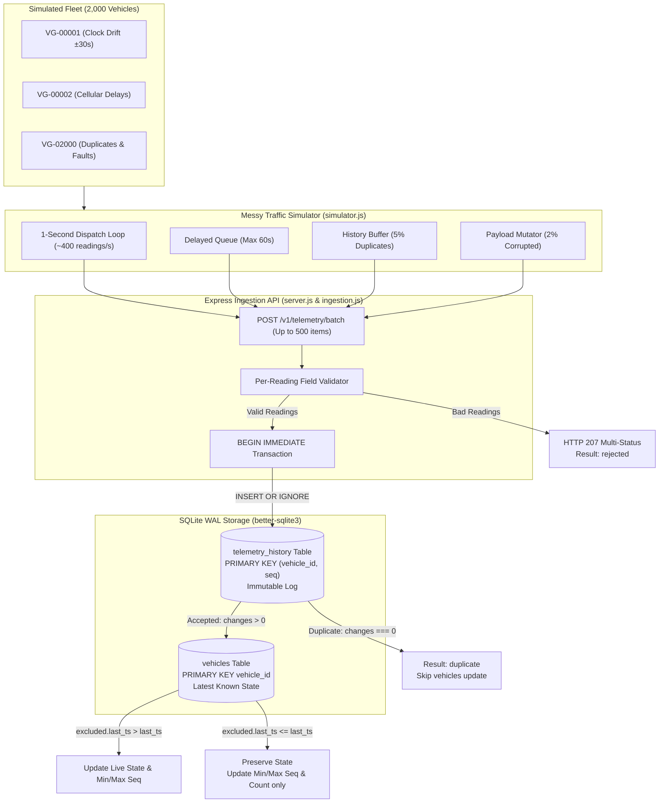
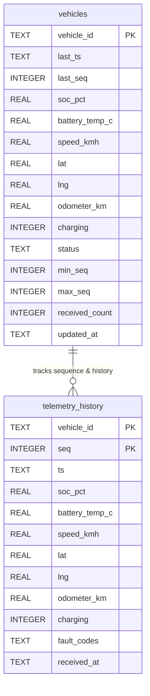

# VoltGrid Fleet Telemetry Service — Phase 1 Master Plan & Tutorial Guide

This document is the complete architectural master plan and tutorial guide for **Phase 1 (Batch Ingestion, SQLite Storage, and Messy Traffic Simulator)** of the VoltGrid Fleet Telemetry Service. Use this guide to explain the system end-to-end during code reviews, interviews, and technical demonstrations.

---

## 1. System Overview & The Core Engineering Challenge

### The Real-World Scenario
VoltGrid operates a commercial fleet of **2,000 electric two-wheelers** across a metropolitan area. Every 5 seconds, each vehicle transmits sensor telemetry over cellular networks:
* State of Charge (`soc_pct`)
* Battery Temperature (`battery_temp_c`)
* Speed (`speed_kmh`) & Odometer (`odometer_km`)
* GPS Coordinates (`lat`, `lng`)
* Charging status (`charging`) & Diagnostic trouble codes (`fault_codes`)

At full scale, the fleet generates **~400 readings per second** (roughly 35 million readings per day).

### The Cellular Network Realities ("Messy Input")
In real-world IoT networks, cellular connections are notoriously unreliable:
1. **Network Retries & Duplicates**: When an ACK is delayed, firmware resends readings (~5% duplicate rate).
2. **Out-of-Order & Delayed Delivery**: Vehicles driving through tunnels or dead zones buffer readings and dump them in bursts up to 10 minutes later (~10% delayed rate).
3. **Clock Drift**: Device RTC (Real-Time Clocks) are not atomic and drift by ±30 seconds relative to the server clock.
4. **Corrupted / Malformed Payloads**: Faulty sensors or bit flips send impossible values (e.g., `soc_pct: 140%`, negative speeds, missing IDs).

Phase 1 establishes the ingestion pipeline that ingests, validates, deduplicates, and correctly orders this high-throughput stream without data loss, deadlocks, or state corruption.

---

## 2. High-Level Architecture Diagram



---

## 3. Database Architecture & Concurrency Strategy

The persistence layer uses SQLite via `better-sqlite3`. SQLite was selected for zero-latency in-process querying, but requires specific configuration to handle high concurrency.

### Key Pragmas & Configuration (`backend/src/db.js`)
* **`PRAGMA journal_mode = WAL;`** (Write-Ahead Logging):
  * *Traditional Rollback Journal*: Locks the entire database during writes; readers cannot read while a writer is writing.
  * *WAL Mode*: Writes are appended to a separate `-wal` file. **Readers and writers never block each other**, providing massive throughput improvements.
* **`PRAGMA busy_timeout = 5000;`**:
  * If two concurrent writes clash, instead of immediately crashing with `SQLITE_BUSY`, SQLite retries internally for up to 5,000ms.
* **`PRAGMA synchronous = NORMAL;`**:
  * In WAL mode, `NORMAL` synchronizes disk buffers at WAL checkpoints rather than on every transaction, boosting write performance by an order of magnitude without risking database corruption.

### The Dual-Table Architecture (`migrations/001_init.sql`)



1. **`telemetry_history` (The Time-Series Log)**:
   * Stores every single reading ever received.
   * `PRIMARY KEY (vehicle_id, seq)`: Enforces database-level idempotency. If network packet duplication delivers the exact same reading twice, SQLite guarantees no duplicate row is ever written.
   * Indexed on `(vehicle_id, ts)` for fast temporal lookups.
2. **`vehicles` (The Current State Table)**:
   * Stores exactly 1 row per vehicle representing its latest operational state.
   * Indexed on `status` and `(lat, lng)`.
   * Tracks sequence boundaries (`min_seq`, `max_seq`, `received_count`) to detect dropped packets.

---

## 4. Part A1: Batch Ingestion API Deep Dive

### Endpoint: `POST /v1/telemetry/batch`
Accepts a JSON array or `{ readings: [...] }` of up to 500 readings. Batches larger than 500 or empty batches are rejected with `HTTP 400`.

### 1. Partial Success & Individual Validation
A batch must **never** fail entirely because of one corrupt reading. 
* Every reading is validated against strict range checks:
  * `vehicle_id`: Non-empty string.
  * `seq`: Integer $\ge 0$.
  * `ts`: Valid ISO 8601 timestamp string.
  * `soc_pct`: $0 \le x \le 100$.
  * `battery_temp_c`: $-40 \le x \le 120$.
  * `speed_kmh`: $0 \le x \le 200$.
  * `lat`: $-90 \le x \le 90$; `lng`: $-180 \le x \le 180$.
  * `odometer_km`: $\ge 0$.
  * `charging`: Boolean.
  * `fault_codes`: Array.
* **Response Codes**:
  * **`HTTP 200`**: All readings in the batch were valid or duplicate.
  * **`HTTP 207 Multi-Status`**: One or more readings were rejected.
  * The response payload details the exact status and error for each reading:
    ```json
    {
      "accepted": 490,
      "duplicates": 8,
      "rejected": 2,
      "results": [
        { "index": 0, "vehicle_id": "VG-001", "seq": 100, "status": "accepted" },
        { "index": 1, "vehicle_id": "VG-001", "seq": 100, "status": "duplicate" },
        { "index": 2, "vehicle_id": "VG-002", "seq": 5, "status": "rejected", "error": "soc_pct must be a number between 0 and 100" }
      ]
    }
    ```

### 2. Transaction Isolation & Deadlock Prevention
All valid readings in a batch are processed inside:
```javascript
const executeBatchTransaction = db.transaction((validItems, nowIso) => {
  // Batch insertion logic
}).immediate;
```
* **Why `.immediate` (`BEGIN IMMEDIATE`)?**
  Default SQLite transactions start in `DEFERRED` mode. If two concurrent workers read, and both subsequently attempt to write, both try to upgrade to a write lock simultaneously, resulting in immediate `SQLITE_BUSY` deadlocks. `BEGIN IMMEDIATE` acquires the reserved write lock at transaction start, serializing concurrent batch writes cleanly.

### 3. Deduplication Logic
Each reading is inserted using:
```sql
INSERT OR IGNORE INTO telemetry_history (...) VALUES (...);
```
* If `info.changes === 0`: The composite key `(vehicle_id, seq)` already exists.
* The item is marked as `"status": "duplicate"`.
* **Critical**: Duplicate readings do **not** touch the `vehicles` table and do **not** increment `received_count`.

### 4. Device Timestamp (`ts`) Ordering vs Arrival Order
A common flaw in naive systems is updating vehicle state based on server arrival order.

> **Scenario**:
> 1. At 10:00:00, Vehicle A enters a tunnel (battery = 80%, lat = 13.08). The reading is buffered on the device.
> 2. At 10:00:05, Vehicle A exits the tunnel (battery = 79%, lat = 13.09) and sends reading #2. Reading #2 arrives at server at 10:00:06.
> 3. At 10:00:10, delayed reading #1 finally arrives at the server.

If the server overwrites state on arrival, the vehicle dashboard would show the car at 80% battery and its older location!

**The VoltGrid Solution**:
We use an SQLite `ON CONFLICT(vehicle_id) DO UPDATE` with conditional `CASE` statements:
```sql
ON CONFLICT(vehicle_id) DO UPDATE SET
  last_ts = CASE WHEN excluded.last_ts > vehicles.last_ts THEN excluded.last_ts ELSE vehicles.last_ts END,
  last_seq = CASE WHEN excluded.last_ts > vehicles.last_ts THEN excluded.last_seq ELSE vehicles.last_seq END,
  soc_pct = CASE WHEN excluded.last_ts > vehicles.last_ts THEN excluded.soc_pct ELSE vehicles.soc_pct END,
  battery_temp_c = CASE WHEN excluded.last_ts > vehicles.last_ts THEN excluded.battery_temp_c ELSE vehicles.battery_temp_c END,
  speed_kmh = CASE WHEN excluded.last_ts > vehicles.last_ts THEN excluded.speed_kmh ELSE vehicles.speed_kmh END,
  lat = CASE WHEN excluded.last_ts > vehicles.last_ts THEN excluded.lat ELSE vehicles.lat END,
  lng = CASE WHEN excluded.last_ts > vehicles.last_ts THEN excluded.lng ELSE vehicles.lng END,
  odometer_km = CASE WHEN excluded.last_ts > vehicles.last_ts THEN excluded.odometer_km ELSE vehicles.odometer_km END,
  charging = CASE WHEN excluded.last_ts > vehicles.last_ts THEN excluded.charging ELSE vehicles.charging END,
  status = 'online',
  min_seq = MIN(vehicles.min_seq, excluded.min_seq),
  max_seq = MAX(vehicles.max_seq, excluded.max_seq),
  received_count = vehicles.received_count + 1,
  updated_at = excluded.updated_at;
```
* **Newer reading (`excluded.last_ts > vehicles.last_ts`)**: Overwrites telemetry state.
* **Late reading (`excluded.last_ts <= vehicles.last_ts`)**: Telemetry state is preserved.
* **Both cases**: Stored in `telemetry_history`, sequence min/max boundaries are expanded, and `received_count` is incremented.

---

## 5. Sequence Gap & Data Completeness (`GET /v1/completeness`)

How do we prove whether packets were dropped in transit?
* Every vehicle maintains a monotonically increasing sequence counter: $\text{seq} = 1, 2, 3, \dots$
* If a vehicle produces sequence numbers from $\min(\text{seq})$ to $\max(\text{seq})$, the total expected readings is:
  $$\text{Total Expected} = \sum (\text{max\_seq} - \text{min\_seq} + 1)$$
* The completeness percentage is:
  $$\text{Completeness \%} = \frac{\sum \text{received\_count}}{\text{Total Expected}} \times 100$$

Query executed on `GET /v1/completeness`:
```sql
SELECT 
  COUNT(*) AS total_vehicles,
  COALESCE(SUM(received_count), 0) AS total_received,
  COALESCE(SUM(max_seq - min_seq + 1), 0) AS total_expected
FROM vehicles;
```

---

## 6. Messy Traffic Simulator (`simulator/simulator.js`)

The simulator is a standalone, dependency-free Node.js script using native `fetch` that emulates realistic field conditions:

| Parameter | Default | Purpose |
| :--- | :--- | :--- |
| `NUM_VEHICLES` | `2,000` | Vehicles `VG-00001` to `VG-02000` |
| `REPORT_INTERVAL_MS` | `5,000` | Each vehicle reports every 5s (~400 req/sec) |
| `DUPLICATE_RATE` | `0.05` (5%) | Samples from a ring buffer of recently sent readings |
| `LATE_RATE` | `0.10` (10%) | Diverts readings into a delayed queue for out-of-order dispatch |
| `MAX_LATE_MS` | `60,000` | Max delay time for late queue |
| `MAX_DRIFT_MS` | `30,000` | Fixed per-vehicle clock drift in range $[-30\text{s}, +30\text{s}]$ |
| `MALFORMED_RATE` | `0.02` (2%) | Corrupts fields (out-of-bound temps, bad types, missing IDs) |
| `BATCH_SIZE` | `500` | Max payload size sent to the API |

---

## 7. Containerization & Deployment

* **`Dockerfile`**:
  * Base: `node:20-bookworm-slim`
  * System tools: `python3`, `make`, `g++` for native compilation of `better-sqlite3`.
  * Multi-stage structure copying manifests first to maximize Docker layer cache hits.
* **`docker-compose.yml`**:
  * Exposes port `3000`.
  * Mounts a named persistent volume: `sqlite_data:/data`.
  * Even if the container is rebuilt or destroyed, the database remains completely intact.

---

## 8. Live Review Defense Guide (Cheatsheet)

When walking through your code in an interview or technical review, use these exact answers:

### Q1: "Show me the exact line that stops a late reading from overwriting newer state."
> **Answer**: 
> *"In `backend/src/ingestion.js` (inside `upsertVehicleStmt`), look at the `ON CONFLICT(vehicle_id) DO UPDATE SET` clause:*
> ```sql
> last_ts = CASE WHEN excluded.last_ts > vehicles.last_ts THEN excluded.last_ts ELSE vehicles.last_ts END,
> soc_pct = CASE WHEN excluded.last_ts > vehicles.last_ts THEN excluded.soc_pct ELSE vehicles.soc_pct END
> ```
> *If a reading arrives with an older device timestamp (`excluded.last_ts <= vehicles.last_ts`), the state fields remain unchanged. However, the reading is still inserted into `telemetry_history` and `min_seq`/`max_seq` are expanded."*

### Q2: "Two clients send the same batch at the exact same instant. Walk me through what the database does."
> **Answer**:
> *"1. Both requests invoke `executeBatchTransaction`, wrapped in `db.transaction(...).immediate()`.
> 2. SQLite immediately acquires a write lock (`BEGIN IMMEDIATE`) for the first transaction; the second transaction waits transparently (up to 5,000ms via `PRAGMA busy_timeout`).
> 3. Transaction 1 executes `INSERT OR IGNORE INTO telemetry_history`. It inserts the rows and upserts into `vehicles`.
> 4. Transaction 1 commits and releases the lock.
> 5. Transaction 2 acquires the write lock and attempts `INSERT OR IGNORE`. Because `(vehicle_id, seq)` is the primary key, SQLite ignores the inserts (`info.changes === 0`).
> 6. The code detects `changes === 0`, increments `duplicates`, and bypasses the `vehicles` upsert entirely. Zero duplicate rows and zero double-counting occur."*

### Q3: "Why did you choose `HTTP 207 Multi-Status`?"
> **Answer**:
> *"In IoT batch ingestion, rejecting an entire batch because 1 out of 500 readings had bad sensor data causes severe data loss. `HTTP 207 Multi-Status` (RFC 4918) allows the server to accept the 499 valid readings while reporting the exact errors for the rejected items, making edge debugging straightforward."*
